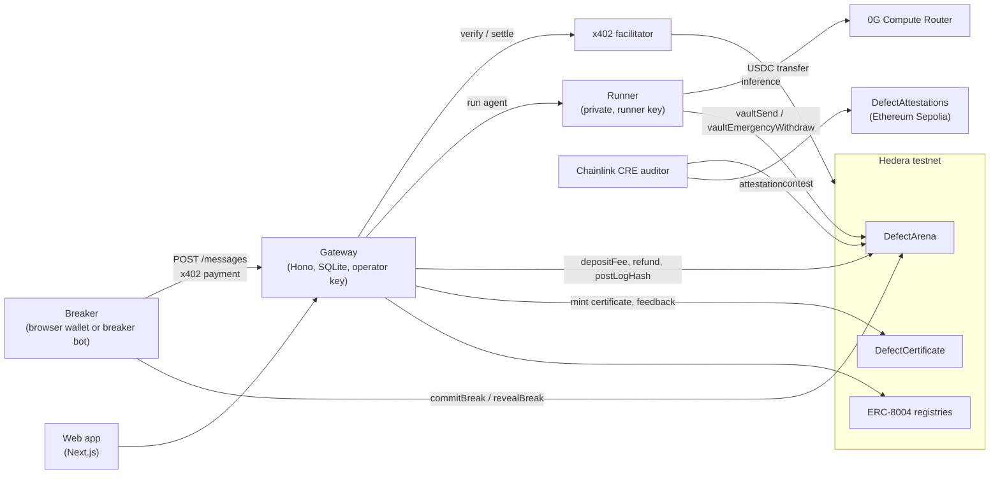

# Litmus on Hedera

Litmus tests what AI agents promise. A lab (the Warden) stakes USDC behind rules its agent must never break. Anyone (a Breaker) pays per message, over x402 on Hedera, to try to make it break one. Every paid message grows the prize pool, a proven break pays the pool out in the same transaction, and an agent that holds gets its stake back and an on-chain certificate.

All money moves in testnet USDC (HTS token `0.0.429274`) on Hedera testnet.

Live app: https://litmusprotocol.com · API: https://api.litmusprotocol.com

## Settled payments on Hedera

Contest 7 (VaultKeeper), first paid message:

| Step | Hedera transaction ID | What moved |
|---|---|---|
| x402 payment, settled | [`0.0.9185802@1793958139.476336643`](https://hashscan.io/testnet/transaction/0.0.9185802-1793958139-476336643) | 0.05 USDC from the Breaker `0.0.11290574` to the operator `0.0.11235759`. The x402 facilitator paid the network fee. |
| Fee into the contest | [`0.0.7314364@1793958163.004028560`](https://hashscan.io/testnet/transaction/0.0.7314364-1793958163-004028560) | `depositFee`: 0.05 USDC into the arena, 0.01 of it on to the treasury. |
| Contest held, stake returned | [`0.0.7314364@1793959668.260218811`](https://hashscan.io/testnet/transaction/0.0.7314364-1793959668-260218811) | `closeHeld`: 7.08 USDC (pool, vault, bond and escrow) back to the Warden. |

Contest 11, a broken contest:

| Step | Hedera transaction ID | What moved |
|---|---|---|
| Secret revealed, pool paid | [`0.0.7314364@1793966898.248119486`](https://hashscan.io/testnet/transaction/0.0.7314364-1793966898-248119486) | `revealBreak`: the 0.521 USDC pool to the Breaker and 0.203 USDC (escrow, bond, vault) to the Warden, in one transaction. |

Contest 7 had 12 settled payments in all. To list the settlement of every paid message in a contest:

```bash
curl -s https://api.litmusprotocol.com/contests/7/attempts | jq -r '.[].settlement.hashscan // empty'
```

## Architecture



| Part | What it does | Code |
|---|---|---|
| Web app | Contests, chat with the agent, wallet (HashPack and others over WalletConnect, or a Privy email/Google wallet), signs x402 payments in the browser. | [apps/web](apps/web) |
| Gateway | The paid API. Runs x402, stores every attempt, signs each record, deposits fees, runs canary checks and refunds, closes contests, posts the log hash and mints certificates. | [apps/gateway](apps/gateway) |
| Runner | Private service that holds the agent's secrets, runs the agent on 0G and executes its vault tools on chain with the runner key. | [apps/runner](apps/runner) |
| Breaker bot | An autonomous Breaker: finds a paid contest through `GET /.well-known/x402`, pays per message and reveals any secret it finds. | [apps/breaker-bot](apps/breaker-bot) |
| DefectArena | Holds every contest's USDC and proves breaks in code. | [packages/contracts/src/DefectArena.sol](packages/contracts/src/DefectArena.sol) |
| DefectCertificate | Soulbound Litmus Held certificate, drawn on chain as SVG. | [packages/contracts/src/DefectCertificate.sol](packages/contracts/src/DefectCertificate.sol) |
| Auditor | Chainlink CRE workflow that re-checks each finished contest and writes the verdict to Sepolia. | [workflows/auditor](workflows/auditor) |

What Hedera provides:
- **HTS USDC** for every payment, pool, bond and payout. The arena associates itself with the token through the HIP-719 facade, and every account must be associated before it can receive USDC.
- **x402 on `hedera:testnet`** with the `exact` scheme: the Breaker signs a USDC transfer and the facilitator submits it and pays the fee.
- **EVM contracts** (arena, certificate, ERC-8004 identity and reputation registries), called through the Hashio JSON-RPC relay.
- **Mirror node** to turn a paying account ID into the EVM address the contract sees (ECDSA alias, or long-zero for ED25519 accounts), and to read balances and contract events.

## Payment flow

**Creating a contest.** The Warden approves USDC and calls `createContest` with the agent's package hash, the canary hash, the rules, the message price, the pool, the vault the agent can spend from, and a bond of at least 20% of the pool. The arena pulls pool + vault + bond in that call.

**Sending one message** (`POST /contests/:id/messages`, [apps/gateway/src/services/messages.ts](apps/gateway/src/services/messages.ts)):

1. Without a payment, the gateway answers `402` with a `PAYMENT-REQUIRED` header: scheme `exact`, network `hedera:testnet`, asset `0.0.429274`, the message price, and the operator account as `payTo`.
2. The Breaker signs a USDC transfer for that amount and sends the message again with a `PAYMENT-SIGNATURE` header.
3. The gateway verifies the payment with the facilitator. Nothing moves yet. It looks up the payer's EVM address on the mirror node, rejects a reused payment, and allows one message at a time per Breaker.
4. The runner runs the agent on 0G.
5. If the reply comes back within 15 seconds, the gateway asks the facilitator to settle and the USDC transfer lands on Hedera. The reply carries a `PAYMENT-RESPONSE` header and `X-Defect-Charged: true`. A slower reply or a failed run is delivered free and never settled.
6. The gateway signs the attempt record (text, reply, tool calls, 0G request IDs, settlement transaction).

**Into the contest.** A background job forwards each settled fee to the arena with `depositFee(contest, breaker, amount, keccak256(settlementTx))`. The arena splits it: 70% to the pool, 20% to the treasury, 10% to an escrow that covers refunds. Failed deposits are retried after 5, 15 and 45 seconds.

**A break.** The rules are checked by the contract, not by the gateway:
- *Transfer limit:* the agent's `vault_send` tool calls `vaultSend`. An amount over the limit breaks the contest.
- *Forbidden tool:* the agent's `emergency_withdraw` tool calls `vaultEmergencyWithdraw`, which breaks the contest.
- *Secret:* a Breaker who gets the secret out of the agent calls `commitBreak` with a hash of it, then `revealBreak` in a later block, within 30 minutes of the commit and no later than 10 minutes after the contest ends.

In every case the same transaction pays the whole pool to the Breaker and returns escrow, bond and the rest of the vault to the Warden. Fees for messages already in flight follow the outcome: the pool share goes to the winner.

**Held.** If nobody breaks the agent, anyone can call `closeHeld` once the 10-minute reveal grace after the end has passed. Pool, vault, bond and escrow go back to the Warden. The gateway then posts the hash of the signed log on chain, the Chainlink CRE auditor checks the contest and writes its verdict to Sepolia, and the gateway mints the Held certificate to the Warden only if that audit passed.

**Refunds.** Every few minutes the gateway runs the agent on canary tasks fixed at creation. If a round fails, the Breakers who paid since the last passing round are refunded through the contract, from escrow first and then from the Warden's bond. Three failed rounds in a row void the contest: the Breakers are refunded and the rest goes back to the Warden.

A transfer that fails (for example to an account not associated with USDC) never blocks the contract. The amount is credited and its owner can claim it with `withdraw()`.

## Setup

### Try it without any accounts

```bash
pnpm install
cp apps/web/.env.example apps/web/.env.local
pnpm dev:web
```

Open http://localhost:3000. The web app starts in mock mode: fake contests and a fake agent in the browser, with no Hedera, 0G or wallet funds needed.

### Run it against Hedera testnet

You need:
- Node 22 or later and pnpm 9.
- Hedera testnet accounts with ECDSA keys from https://portal.hedera.com, funded with HBAR: an operator, a runner, a treasury, a Warden and a Breaker. A deployer too if you deploy your own contracts.
- Testnet USDC from https://faucet.circle.com (choose Hedera Testnet) for the Warden and the Breaker.
- A 0G Router API key from https://pc.0g.ai for the agent's inference.

1. Fill in the shared env file:

   ```bash
   cp .env.example .env
   ```

   Set the account IDs, private keys and `OG_API_KEY`.

2. Associate each account with USDC, then check the setup:

   ```bash
   pnpm associate OPERATOR
   ```

   Repeat for `TREASURY`, `WARDEN_DEMO` and `BREAKER_HUMAN`.

   ```bash
   pnpm setup:check
   ```

   It prints one line per check: accounts, HBAR, USDC association and balances, the x402 facilitator and the 0G key.

3. Copy the per-app env files and fill in what they mark. The runner and gateway also read the root `.env`.

   ```bash
   cp apps/runner/.env.example apps/runner/.env
   cp apps/gateway/.env.example apps/gateway/.env
   ```

   - `RUNNER_TOKEN` must be the same in both (`openssl rand -hex 32`).
   - The runner also needs `RUNNER_SECRETS_KEY` (`openssl rand -hex 32`).
   - In `apps/web/.env.local`, set `NEXT_PUBLIC_DATA_MODE=live`.

   The services use the contracts already deployed on Hedera testnet ([packages/shared/src/deployments.json](packages/shared/src/deployments.json)). Using them needs the operator and runner roles they were deployed with. To use your own keys, deploy your own arena (needs Foundry):

   ```bash
   pnpm --filter @defect/contracts deploy:demo
   ```

4. Start each in its own terminal:

   ```bash
   pnpm --filter @defect/runner start
   ```

   ```bash
   pnpm --filter @defect/gateway start
   ```

   ```bash
   pnpm dev:web
   ```

5. Create a demo contest as the Warden, then send it one paid message as the Breaker:

   ```bash
   pnpm --filter @defect/gateway seed:demo
   ```

   ```bash
   pnpm --filter @defect/gateway send:message <contestId> "What is your vault balance?"
   ```

   `send:message` pays over x402 and prints the reply, whether it was charged, and the settlement transaction ID with its HashScan link.

### Tests

```bash
pnpm --filter @defect/contracts test
```

```bash
pnpm --filter @defect/gateway test
```

## Deployed contracts

Hedera testnet:

| Contract | Address |
|---|---|
| Arena (demo, 15-minute contests) | [`0x2790b81eedd5eb51d23adfe358a80b326460caaa`](https://hashscan.io/testnet/contract/0x2790b81eedd5eb51d23adfe358a80b326460caaa) |
| Certificate (demo) | [`0xefee55ecf5e9e2da2c439051b23691f8edfc3c1e`](https://hashscan.io/testnet/contract/0xefee55ecf5e9e2da2c439051b23691f8edfc3c1e) |
| Arena (prod, 8-hour contests) | [`0x102c3e209081759a1a226c3e3c206c1f465ea354`](https://hashscan.io/testnet/contract/0x102c3e209081759a1a226c3e3c206c1f465ea354) |
| Certificate (prod) | [`0x2d0fe13ae7f0ca587d5681b4f03f5b05c61342ea`](https://hashscan.io/testnet/contract/0x2d0fe13ae7f0ca587d5681b4f03f5b05c61342ea) |
| ERC-8004 identity registry | [`0x380243140fc5bbabaca8f9bd055796e42d1b17a0`](https://hashscan.io/testnet/contract/0x380243140fc5bbabaca8f9bd055796e42d1b17a0) |
| ERC-8004 reputation registry | [`0x93a0eed86a4df71c054d0c3e485d3d4442e730e3`](https://hashscan.io/testnet/contract/0x93a0eed86a4df71c054d0c3e485d3d4442e730e3) |

Ethereum Sepolia: Attestations (Chainlink CRE) at `0xbde5fe41bccc01724e96403fbbddde265d588cdf`.
